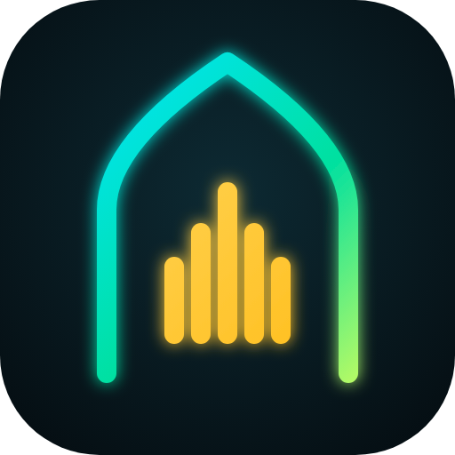
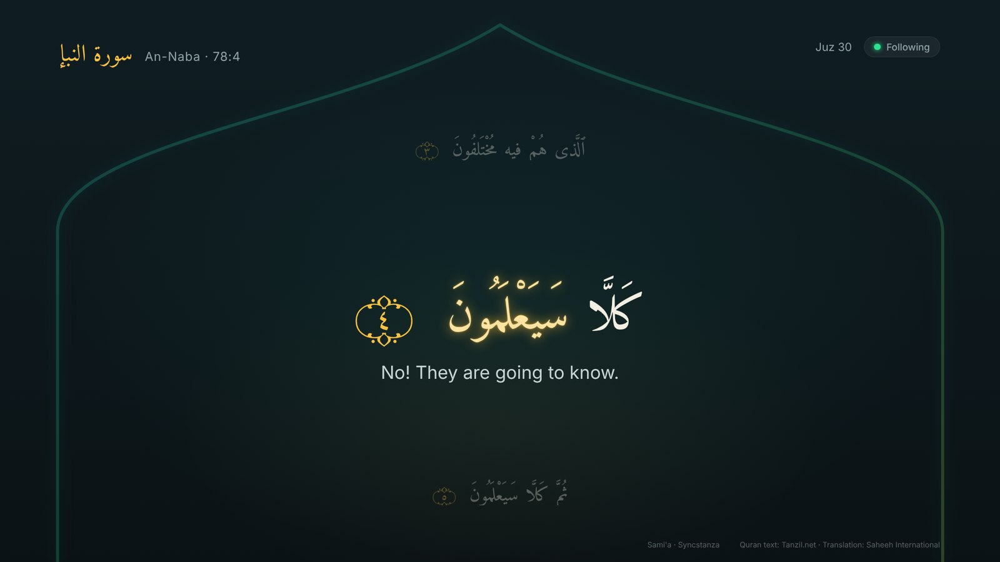
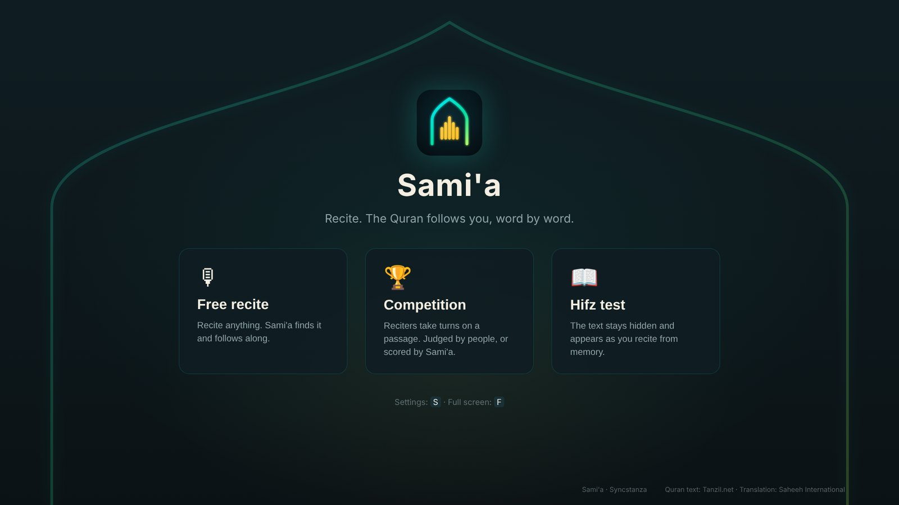
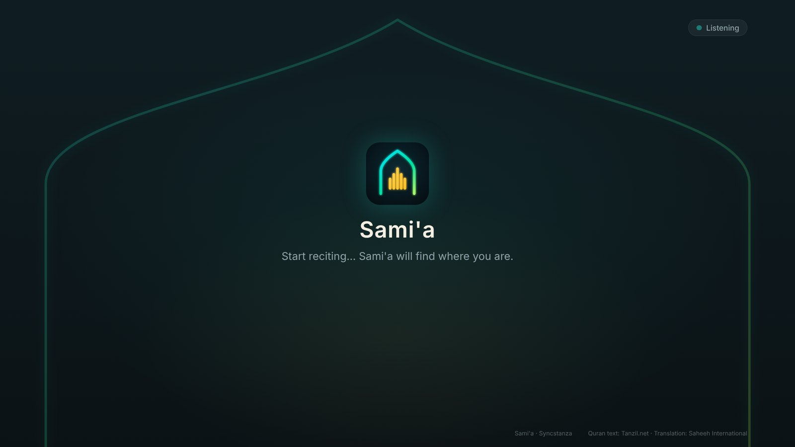
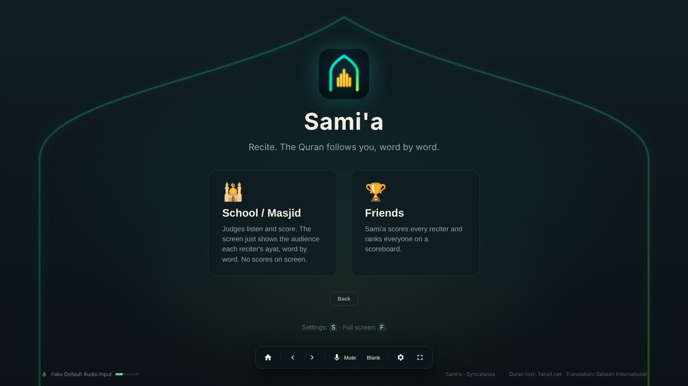
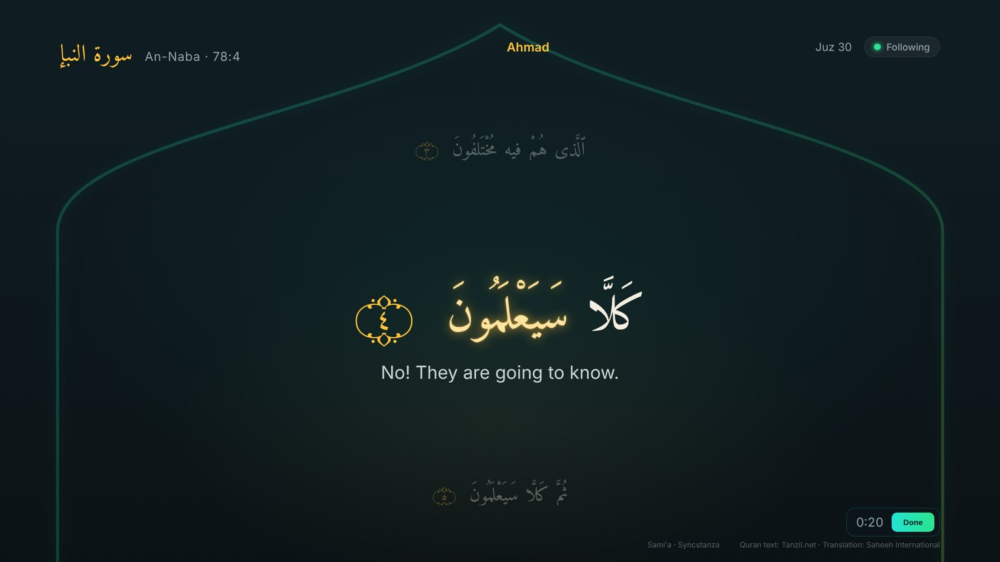
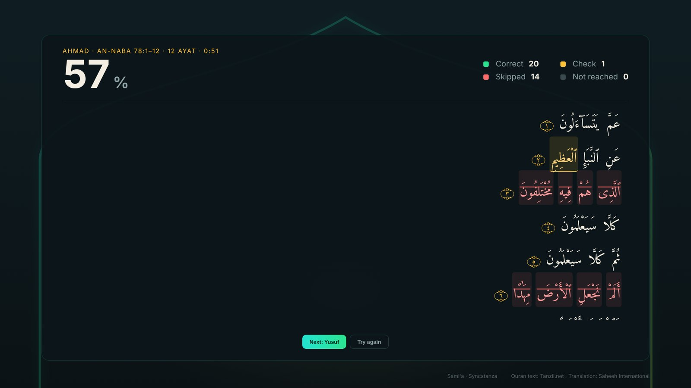
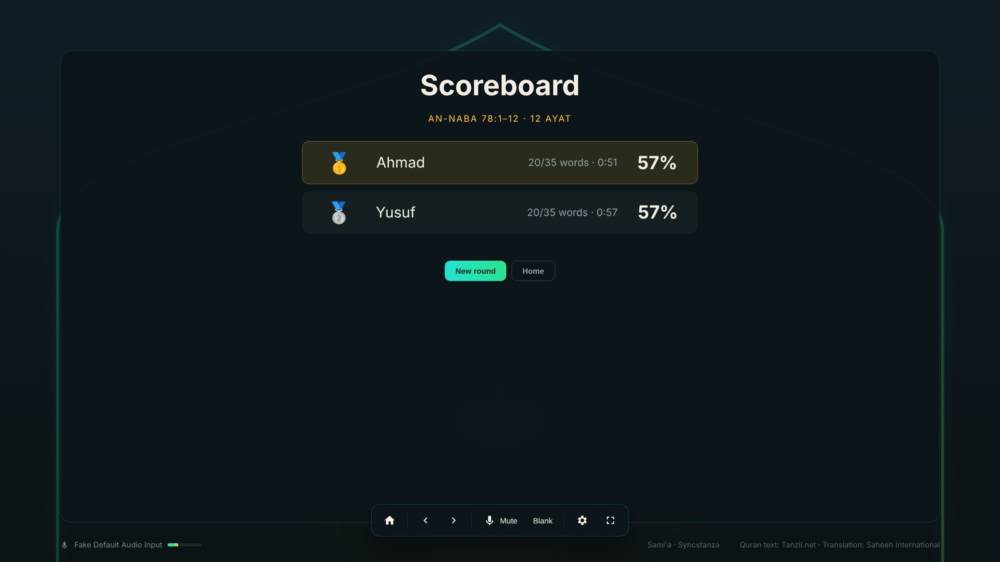
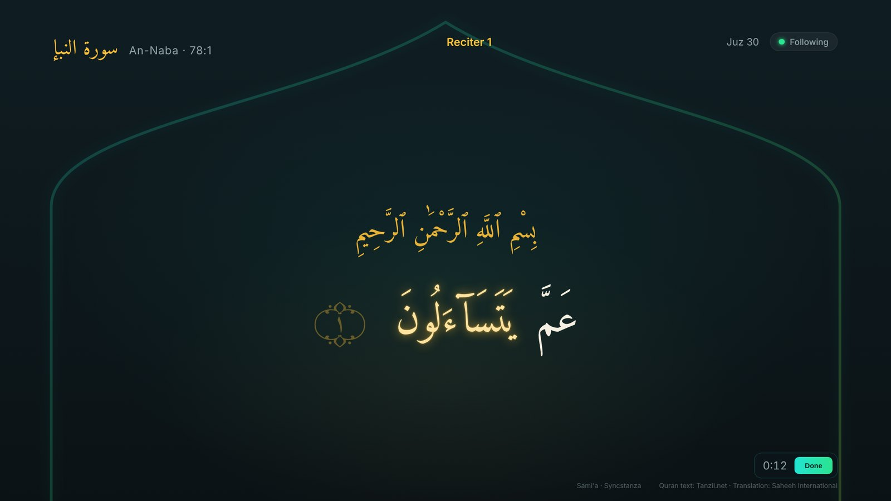

<div align="center">



# Sami'a

<sub>Made by **Syncstanza**</sub>

**Quran karaoke for masjids, classes and friends. Sami'a listens as you recite, lights up each word on the big screen, and scores how well you read it. Recite freely, run a competition, or test your hifz. Free and fully offline.**

[](https://github.com/Syncstanza/samia/releases/latest)


<br>



<sub>Free recite: the ayah being recited, lit up word by word, with the translation underneath.</sub>

</div>

---

## ⬇️ Download

**[Get the latest version →](https://github.com/Syncstanza/samia/releases/latest)**

| You have | Download |
|---|---|
| Windows 10 / 11 | `Samia-Setup-x.y.z.exe` (installer) or `Samia-x.y.z.exe` (no install) |
| Linux | `Samia-x.y.z.AppImage` |
| Android phone / tablet | `Samia-x.y.z.apk`: open the release page on the phone, tap the file, allow installs from your browser when asked |

Windows may say "Windows protected your PC" because the app isn't signed yet: click **More info → Run anyway**.

---

## ✨ What you get

| | |
|---|---|
| 🎤 **Free recite** | Just start reciting anywhere in the Quran. Sami'a finds the ayah and follows along, lighting up each word as you reach it. |
| 🕌 **School / Masjid competition** | For judged events. Each reciter takes a turn on the chosen passage while the audience follows every word on the big screen. No scores are shown: the judges decide. |
| 🏆 **Friends competition** | Take turns on a passage. Sami'a scores everyone and a scoreboard ranks them at the end. |
| 🧠 **Hifz test** | The text is hidden. Words only appear once you've recited them, so you can check your memorisation without peeking. Pick a passage, or **recite from anywhere** and be scored on exactly what you recited. |
| 💯 **Accuracy score** | In Friends and Hifz test, after each turn you get a percentage and the whole passage with every word marked: ✅ correct, 🟡 check (said differently), ❌ skipped, ⚪ not reached. |
| 📖 **Arabic + translation** | Large Uthmani script with an English translation underneath. |
| 🎛 **Easy controls** | Mouse, keyboard or a USB presenter clicker. Controls hide until you move the mouse. |
| 📶 **No internet needed** | Speech recognition runs on the computer itself. |
| 🔄 **Updates in one click** | When a new version is out, *Update available* appears on the home screen. One click downloads it, checks it and restarts. Settings shows the version, *Check for updates* and *What's new*. |
| 📣 **Announcements** | News and tips from Syncstanza in a small bar on the home screen (can be turned off in Settings). |
| 🔒 **Nothing is recorded** | Audio is processed live and thrown away. Nothing is saved or sent anywhere. |
| 🌍 **More languages** | Bengali, Urdu and more translations come *later*. |

---

## 📸 Screenshots

<table>
  <tr>
    <td width="50%"></td>
    <td width="50%"></td>
  </tr>
  <tr>
    <td><b>Home</b>: pick a mode.</td>
    <td><b>Free recite</b>: shows what it hears until it finds the ayah, usually within a few seconds.</td>
  </tr>
  <tr>
    <td></td>
    <td></td>
  </tr>
  <tr>
    <td><b>Competition</b>: judged by people (School / Masjid) or scored by Sami'a (Friends).</td>
    <td><b>A turn</b>: the audience follows the reciter's ayat on the big screen.</td>
  </tr>
  <tr>
    <td></td>
    <td></td>
  </tr>
  <tr>
    <td><b>Score</b>: every word marked: correct, 🟡 check, ❌ skipped.</td>
    <td><b>Scoreboard</b>: Friends competitions rank everyone at the end.</td>
  </tr>
  <tr>
    <td></td>
    <td></td>
  </tr>
  <tr>
    <td><b>Hifz test</b>: the text stays hidden and appears only as you recite it.</td>
    <td></td>
  </tr>
</table>

---

## ✅ What you need

| | Minimum | Recommended | Notes |
|---|---|---|---|
| 💻 **Computer** | 64-bit Windows 10 or Linux laptop / mini PC, 4-core CPU, 8 GB RAM | Any recent laptop, or a mini PC behind the TV | It runs the speech model locally. |
| 📺 **Screen** | Any TV or projector with HDMI | 1080p or 4K TV | |
| 🎙 **Audio** | Any microphone | A handheld or headset mic close to the reciter | A close mic in a quiet room gives the best scores. |
| 📱 **Phone / tablet** | Android 7 or newer, 3 GB RAM | A phone from the last few years | Same speech model, same screens, on the phone. Portrait or landscape. |
| 🎛 **Control** (optional) | A phone on the same network | A USB presenter clicker | The clicker works even with no network at all. |

---

## 🕹 How a turn works

1. Choose a mode on the home screen.
2. **Competition** asks: *School / Masjid* (judged) or *Friends* (scored). For a competition or Hifz test, pick the surah and ayat, and add names.
3. Press **Start** (or <kbd>Space</kbd>) and recite. The clock runs and words light up.
4. Press **Done** (or <kbd>Enter</kbd>), or just stop: it ends by itself after the last ayah.
5. Judged: it goes straight to the next reciter. Friends / Hifz: a few seconds later the score and marked words appear, then the next reciter or the scoreboard.

---

## 🛠 How it works

1. **Listen:** audio is read in short chunks on the computer.
2. **Recognise:** a speech model trained on Quran recitation turns the audio into Arabic letters.
3. **Follow:** those letters are lined up against the Quran text so the screen follows live.
4. **Score:** at the end of a turn the whole recording is checked again, word by word, against the chosen passage. Anything said before or after the passage (a'udhu billah, bismillah) doesn't count against you.

---

## 🧪 Run from source

Needs [Node.js 22+](https://nodejs.org). In the project folder:

```bash
npm install          # app + Electron
npm run model        # downloads the Quran speech model (~19 MB)
npm start            # opens Sami'a in a window and starts listening
```

It opens in a normal window; the full-screen button (or <kbd>F</kbd>) toggles full screen. `npm run start:kiosk` starts straight in full screen.
Move the mouse to show the controls (they hide again after 3 seconds). Keys: <kbd>Space</kbd> start a turn, <kbd>Enter</kbd> done, <kbd>H</kbd> home, <kbd>S</kbd> settings (audio input), <kbd>→</kbd>/<kbd>←</kbd> move by hand, <kbd>M</kbd> mute, <kbd>B</kbd> blank, <kbd>F</kbd> full screen.

### Android

The Android app is the same web app in an Android shell ([Capacitor](https://capacitorjs.com)).

```bash
npm run model && node tools/android-www.mjs   # builds android-app/www
cd android-app && npm ci && npx cap sync android
cd android && ./gradlew assembleRelease        # needs the Android SDK (or open android-app/android in Android Studio)
```

No microphone handy? `npm run serve`, then open `http://localhost:4173/?demo=2:255-2:257` to watch it follow a simulated recitation.

---

## 🔐 Privacy

No account, no tracking. Audio never leaves the computer and is never saved.

The only time Sami'a goes online is to check GitHub for a new version and for announcements (a few seconds after start, then every 6 hours). Nothing about you or your recitation is sent. Without internet everything else works the same.

---

## 📜 Credits and license

- **Quran text:** [Tanzil Project](https://tanzil.net), used unmodified.
- **English translation:** Saheeh International, via Tanzil.
- **Arabic font:** Amiri Quran (SIL Open Font License).
- Full details are in [ATTRIBUTION.md](ATTRIBUTION.md).

The app's own code is under the [Apache 2.0 license](LICENSE). The Quran text and translations keep their own terms.

---

<div align="center">

Made by **Syncstanza**, free for every masjid, class and circle of friends.

</div>
